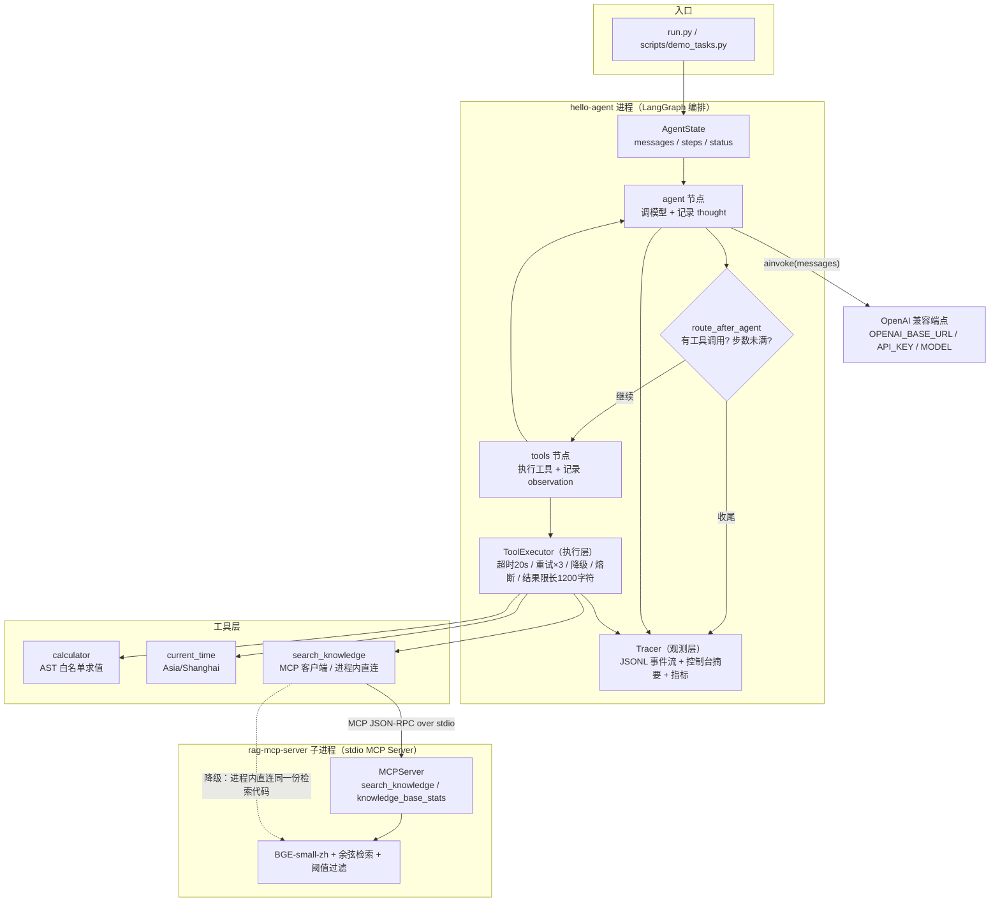
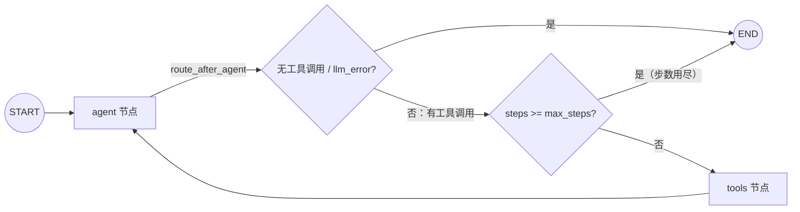

# hello-agent —— 最小 ReAct Agent + 工具调用（LangGraph）

> **一句话**：用 **LangGraph 手写**「模型思考 → 调用工具 → 观察结果 → 再思考」的循环，
> 工具包括**经 MCP 客户端接入的 RAG 检索**（复用项目一 [rag-mcp-server](../rag-mcp-server)）、
> **计算器**与**当前时间**；并把 Agent 里最容易出问题的三件事做成显式机制：
> **最大步数**、**失败重试/降级/熔断**、**每步 thought/action/observation 落 JSONL 的 trace**。
>
> 这不是「跑通教程」，而是一个**可以逐行讲源码**的最小工程件：状态就三个字段、
> 循环就两个节点、失败处理有分类表、日志可完整回放。

**核心事实（都是本机跑出来的，不是描述的）**

| 项目 | 事实 | 证据位置 |
|---|---|---|
| 离线测试 | `41 passed`（40 个纯离线 + 1 个 MCP 端到端，后者用环境变量开启） | §7 |
| 真实任务 | 三条 demo 全部 `status=completed`（步数 3 / 4 / 2，总耗时 30.97s） | §1 |
| 最大步数 | `--max-steps 1` 稳定得到「未完成收尾」，不会假完成 | §1.3 |
| 降级 | 把 MCP 命令改坏后，`auto` 模式如实降级到进程内直连并完成任务 | §1.4 |
| trace | 每个任务一份 JSONL，逐行可回放（含 token 用量与工具成功率） | §6 |

---

## 1. 先看真实运行日志

以下日志来自本机一次真实运行（模型：`deepseek-chat`，温度 0；命令：
`.venv\Scripts\python.exe scripts\demo_tasks.py --rag-mode mcp`），
完整可回放的事件流在仓库 `traces/` 下对应的 JSONL 里。

> **引用约定（先说清楚，不玩「看起来像原文」的把戏）**：控制台输出本身会把单条内容截断到
> 200 字符（以「（截断，共 N 字符）」结尾）；下面的摘录在此之上又省略了部分超长 JSON 字段
> （用 `...` 或 `{...}` 标出）。**完整、未经删改的事件原文只出现在 `traces/*.jsonl` 里**
> （每个任务的时间戳都能对上文件名）。另外：模型在温度 0 下仍有极小随机性，
> **你重跑时的 `run_id`、耗时、措辞会与下面不同**，但机制与结论可复现。

### 1.1 汇总

```text
====================================================================================================
DEMO 汇总
====================================================================================================
Demo 1: status=completed 步数=3 工具调用=3 成功=3 失败=0 重试=0 降级=0 RAG形态=mcp 耗时=10334.99ms
        trace: ...\hello-agent\traces\run_20261016-132736_24486d1f.jsonl
Demo 2: status=completed 步数=4 工具调用=4 成功=4 失败=0 重试=0 降级=0 RAG形态=mcp 耗时=11839.26ms
        trace: ...\hello-agent\traces\run_20261016-132747_e6fca8de.jsonl
Demo 3: status=completed 步数=2 工具调用=2 成功=2 失败=0 重试=0 降级=0 RAG形态=mcp 耗时=8790.31ms
        trace: ...\hello-agent\traces\run_20261016-132759_751d7e9a.jsonl
总耗时 30.97s；trace 目录：D:\programmer\LLM\projects\hello-agent\traces
```

### 1.2 Demo 1：多步工具组合（检索 → 计算 → 取时间）

> 任务：*先查知识库，LoRA 的典型配置里 r 和 α 分别是多少？然后用计算器算 α/r，最后告诉我现在的时间。*

```text
[run 24486d1f] 工具就绪：['calculator', 'current_time', 'knowledge_base_stats', 'search_knowledge'] | RAG 形态=mcp（经 MCP stdio 连接 rag-mcp-server 子进程）
[step 1] llm_call 1303.7ms tokens=in807/out91
[step 1] thought: I'll start by searching the knowledge base for LoRA configuration details.
[step 1]   → action: search_knowledge({"query": "LoRA 典型配置 r 和 alpha 取值", "top_k": 5})
[step 1]   → action: current_time({})
[step 1] observation[search_knowledge] ok in 5.15ms (attempt=1): {"matched": 4, "filtered_by_threshold": 1, ...}
[step 1] observation[current_time] ok in 1.68ms (attempt=1): {"human": "2026年10月16日 13:27:44 星期五", ...}
[step 2] llm_call 775.49ms tokens=in1605/out56
[step 2] thought: Found the LoRA config (r=8, α=16). Now computing α/r:
[step 2]   → action: calculator({"expression": "16/8"})
[step 2] observation[calculator] ok in 0.76ms (attempt=1): {"ok": true, "expression": "16/8", "result": 2}
[step 3] llm_call 1326.25ms tokens=in1691/out179
[run 24486d1f] 结束：status=completed steps=3 耗时=10334.99ms
```

最终回答（节选）：

```text
**1. LoRA 典型配置**（来源：`finetuning.txt`）
- r = 8，α = 16
**2. α/r 计算**
- 16 / 8 = **2**
**3. 当前时间**
- 2026年10月16日 13:27:44（星期五，东八区）
```

值得注意：**「一轮里并发请求两个工具」是模型自己的决策**，不是代码写死的流程；
第 2 步它从检索片段里读出参数后再调计算器，第 3 步不再有工具调用、只输出文字 → 循环收尾。

### 1.3 Demo 2：工具报错 → 模型自我纠正（真实的过程，不是设计好的剧本）

> 任务：*知识库里 chunk_size 的典型取值范围是多少？按上限对 5000 字符文档做固定窗口切分、overlap=50，大约多少 chunk？*

```text
[step 2]   → action: calculator({"expression": "ceil((5000-1024)/(1024-50))+1"})
[step 2] observation[calculator] ok in 1.13ms (attempt=1): {"ok": false,
          "error": "ValueError: 只允许调用白名单函数：abs, cos, exp, log, log10, max, min, pow, round, sin, sqrt, tan",
          "hint": "只支持数字与 + - * / // % ** 及白名单函数（s...（截断）"}
[step 3]   → action: calculator({"expression": "(5000-1024)/(1024-50)"})
[step 3] observation[calculator] ok in 1.56ms (attempt=1): {"ok": true, "result": 4.082135523613963}
[step 4] llm_call 2485.31ms tokens=in2409/out311
[run e6fca8de] 结束：status=completed steps=4 耗时=11839.26ms
```

模型想用 `ceil()`，计算器的 **AST 白名单**拒绝了它并回了可读的 `hint`；
下一轮模型自己改成普通除法继续算，最后给出过程与结论（`≈6 个 chunk`）。
**这正说明了「工具错误应作为可读的观察回给模型」而不是抛异常终止任务。**

### 1.4 三条「坏情况」也是真的跑过的

**(a) 最大步数拦截**（`run.py "..." --max-steps 1`，退出码 1）：

```text
[run 3941a1d2] 端点：... | max_steps=1 | rag_mode=mcp
[step 1] thought: I'll search the knowledge base and calculate that in parallel.
[step 1]   → action: search_knowledge({"query": "Transformer 自注意力公式"})
[step 1]   → action: calculator({"expression": "2**10"})
[run 3941a1d2] 结束：status=max_steps_exceeded steps=1 耗时=7135.98ms
===== 最终回答（status=max_steps_exceeded）=====
（未完成）已达最大步数上限 max_steps=1，本任务被强制收尾。
最后一步仍在请求调用工具：['search_knowledge', 'calculator']，但这些调用没有执行。
最后一步模型已给出的部分内容：I'll search the knowledge base and calculate that in parallel.
如需继续，请提高 config.yaml 的 agent.max_steps 或把任务拆小后重跑。
```

**注意「这些调用没有执行」**：步数用尽时不再执行工具——否则这批调用的结果永远没机会被模型消化，
纯属浪费（这也是一个可以讲的取舍）。

**(b) MCP 连不上 → 自动降级直连**（把 `server_command` 故意改成不存在的路径，仍用 `auto`）：

```text
[run cd75b077] 工具就绪：['calculator', 'current_time', 'search_knowledge'] | RAG 形态=direct（进程内直连 rag-mcp-server 的同源 KnowledgeService）
[step 1] observation[search_knowledge] ok in 4665.77ms (attempt=1): {"matched": 3, ...}
[run cd75b077] 结束：status=completed steps=2 耗时=7422.54ms
```

**(c) 强制进程内直连**（`--rag-mode direct`）：

```text
[run 1e884bb1] 工具就绪：['calculator', 'current_time', 'search_knowledge'] | RAG 形态=direct（进程内直连 rag-mcp-server 的同源 KnowledgeService）
[step 2] thought: **典型范围：256–1024 字符。** 依据 `rag_guide.txt`（chunk_index 4）：...
[run 1e884bb1] 结束：status=completed steps=2 耗时=8192.62ms
```

**(d) Demo 3：知识库里没有的东西，模型如实说没有**（防幻觉，也是「检索质量」的诚实暴露）：

```text
[step 1] observation[search_knowledge] ok in 4.35ms (attempt=1):
         {"query": "武汉天气", "matched": 1, "filtered_by_threshold": 2,
          "results": [{"rank": 1, "score": 0.3006, "source": "rag_guide.txt", ...}]}
[step 2] thought: **没有。** 知识库里没有关于「武汉天气」的内容。依据：
         - 检索「武汉天气」只返回 1 条结果，且是 `rag_guide.txt` 中讲 RAG 系统组件的段落
           （相似度 0.3006，刚好卡在阈值 0.3 上），与天气无关，属于误匹配。
```

这次检索出现了一条 **0.3006 压线误匹配**（阈值 0.3），模型没有据此编造答案，
而是说明了「这是误匹配 + 知识库只有哪几个文档」。**这类边界情况正是 trace 的价值**：
原始片段、分数、阈值都在事件里，事后可以逐行复盘。

---

## 2. 架构



**一次任务的完整路径**：

1. `runner.run_task()` 读 `.env`（端点）+ `config.yaml`（行为参数），建 Tracer；
2. `toolkit.build_toolset()` 组装工具：内置工具 + RAG 工具（MCP 优先，失败按 `auto` 降级）；整个任务**只建一次 MCP 会话**；
3. `graph.build_agent_graph()` 编译状态图，并把**工具 schema 绑定到模型**（`llm.bind_tools`）；
4. 循环：`agent` 节点调模型 → 有工具调用就去 `tools` 节点逐个执行（每次都过 ToolExecutor 的超时/重试/熔断）→ 结果作为 `ToolMessage` 回到 `agent`；
5. 结束条件三选一：模型不再调工具（`completed`）/ 步数用尽（`max_steps_exceeded`）/ 模型故障（`llm_error`）；
6. `runner` 收尾：生成最终回答 + 聚合指标 + 写 `run_end` 事件；`run.py` 用退出码表达结果（completed=0，其余=1）。

---

## 3. 工具清单

| 工具 | 参数 | 返回 | 说明 |
|---|---|---|---|
| `search_knowledge` | `query`, `top_k=3` | JSON：`matched / filtered_by_threshold / results[{rank, score, source, text}]` | **来自 MCP Server**（项目一），也有同名的进程内直连实现 |
| `knowledge_base_stats` | — | JSON：文档数 / chunk 数 / 来源文件 / 阈值 / 模型 | 同样来自 MCP Server（**只接入 MCP 形态时存在**，direct 形态没有它） |
| `calculator` | `expression` | JSON：`{ok, result}` 或 `{ok:false, error, hint}` | AST 白名单：数字、`+ - * / // % **`、`sqrt/log/exp/abs/round/min/max/pow/sin/cos/tan`；**无 `eval`**、禁止属性访问/导入/下标/字符串运算 |
| `current_time` | — | JSON：`date/time/weekday/human` | 时区在构造时固定为 `Asia/Shanghai`，**模型无法传入任意时区字符串** |
| `remember_fact` | `content`, `key=""`, `tags=""` | JSON：`{ok, key, total}` | **跨任务长期记忆**：写入 JSONL；同 key 覆盖；拒绝疑似密钥 |
| `recall_memory` | `query`, `top_k=5` | JSON：`{ok, count, results[{key, content, tags, score}]}` | 按字面重叠召回历史记忆；没命中就返回空（不编造） |

这些工具都在贯彻同一件事：**把模型当作不可信输入源**——参数只走受控通道，错误变成可读反馈而不是崩溃。
（`remember_fact` / `recall_memory` 由 `memory.tools: true` 控制是否注册，见 §5.5。）

### RAG 工具的两种形态

| | 形态 A：MCP 客户端（`mode: mcp` / `auto`） | 形态 B：进程内直连（`mode: direct`） |
|---|---|---|
| 实现 | `langchain-mcp-adapters` + `mcp` 客户端，用 stdio 拉起 `rag-mcp-server/server.py` 子进程 | 把 `../rag-mcp-server` 加进 `sys.path`，直接调用同源的 `KnowledgeService` |
| 优点 | **进程隔离**：BGE 模型与索引都在子进程里；同一个 Server 可同时被 Claude Desktop / Cursor 复用 | 无子进程开销，调试方便 |
| 代价 | 子进程启动 + 索引预热 ≈ 5s（每次任务；日志里 `索引构建完成：5 篇文档 → 5 个 chunk…耗时 5.218s`） | BGE 模型加载进 Agent 进程（同量级耗时 + 数百 MB 内存） |
| 触发 | 默认路径 | ① 降级路径（MCP 不可用 / 工具调用重试耗尽）；② `--rag-mode direct` 轻量跑法 |

`auto` 降级分两层，都在 trace 里留证：
- **会话建不起来**（进程启动失败、握手超时）→ 直接改用直连工具，记 `toolset_fallback` 事件；
- **会话可用但调用失败**（重试耗尽）→ `ToolExecutor` 触发该工具的 fallback（懒加载，正常路径永不把 BGE 拉进 Agent 进程），记 `degrade` 事件。

> 依赖版本事实：`langchain-mcp-adapters==0.3.2` 要求 `mcp<2`，所以这里客户端是 **mcp 1.30.0**，
> 而项目一服务端是 **mcp 2.3.0**。两者在这条 stdio 链路上**真实互通**
> （`HELLO_AGENT_TEST_MCP=1` 时有一个端到端测试专门验证，见 §7）。
> 互操作的依据是**协议本身**，不是 SDK 版本。

---

## 4. 快速开始

```bash
# 1) 独立虚拟环境（Python 3.12 实测）
cd hello-agent
python -m venv .venv
.venv\Scripts\activate                     # Windows
# source .venv/bin/activate                # macOS / Linux

# 2) 安装依赖（版本已在 requirements.txt 固定）
pip install -r requirements.txt

# 3) 配置模型端点：复制 .env.example 为 .env 并填入（.env 已在 .gitignore，不进仓库）
copy .env.example .env
#   OPENAI_BASE_URL=https://api.deepseek.com/v1
#   OPENAI_API_KEY=sk-你的key
#   MODEL=deepseek-chat
#   任何 OpenAI 兼容端点都可以（阿里百炼 / 火山 / 本地 vLLM / Ollama，见 .env.example 里的示例）

# 4) 可选：准备 RAG 工具（默认 auto：MCP 优先，失败自动降级直连）
#    需要先按 ../rag-mcp-server/README.md 装好它的 venv 与依赖（BGE 模型 ~95MB）

# 5) 跑一条任务
.venv\Scripts\python.exe run.py "先查知识库 LoRA 的 r 和 α 取值，再用计算器算 α/r"
```

常用参数：

```bash
.venv\Scripts\python.exe run.py "任意任务" --rag-mode direct   # 不走 MCP，进程内直连检索
.venv\Scripts\python.exe run.py "任意任务" --rag-mode mcp      # 强制 MCP（连不上直接报错，用于验证链路）
.venv\Scripts\python.exe run.py "任意任务" --max-steps 3       # 覆盖最大步数
.venv\Scripts\python.exe run.py "任意任务" --console verbose   # 控制台连最终回答一起打
.venv\Scripts\python.exe scripts\demo_tasks.py                 # 跑三条固定 demo
```

退出码：`0` = `completed`；`1` = 未完成（`max_steps_exceeded` / `llm_error` / `error`）；`2` = 配置缺失（没填 `.env`）。

---

## 5. 可靠性设计与能力增强（本项目的重点）

### 5.1 失败分类与处置

| 类别 | 典型来源 | 处置 | 为什么这么定 |
|---|---|---|---|
| `permanent` 参数错 / 工具不存在 | 模型给错参数、幻觉出不存在的工具 | **不重试**，把「正确用法 + 可用工具列表」回给模型 | 同样参数重试必然同样失败 |
| `retryable` 瞬时故障 | 超时、连接失败、限流 429、5xx | **指数退避重试**，最多 3 次（0.5s→1s→2s，上限 4s） | 瞬时故障等待后大概率自愈 |
| 重试耗尽 → **降级** | 依赖长时间不可用 | 调用该工具注册的 **fallback**（`search_knowledge` → 进程内直连同源检索） | 有等价替代路径就不让整任务失败 |
| **熔断** | 同一工具连续失败 3 次 | **本任务内临时禁用**该工具，并在 observation 里告知模型别再调 | 避免模型把剩余步数浪费在必然失败的调用上（熔断状态不跨任务） |

判定优先级（`classify_error()`）：先看异常类型（`ValidationError/TypeError/ValueError/KeyError/AttributeError` → permanent），
再按关键词命中表（timeout / connection / rate limit / 429 / 502 / 503 / 504 → retryable），
**未知异常一律按 retryable**（「多试一次」的代价远小于「直接放弃」）。

### 5.2 三条硬约束

- **单次工具超时 20s**（`asyncio.wait_for`）：一个卡死的工具不能拖死整个任务；
- **结果进上下文前限长 1200 字符**（截断处标注「原长 N 字符」）：上下文成本握在自己手里；
- **模型侧独立重试**：`llm.max_retries=2` 是 HTTP 层的（网络抖动），与工具层的重试相互独立，互不干扰语义。

### 5.3 图结构（`agent/graph.py`）



状态只有三个字段：

```python
messages: Annotated[List[AnyMessage], add_messages]  # 追加语义（reducer），不是覆盖
steps: int                                           # 已走过几轮「模型思考」
status: str                                          # new / in_progress / completed / llm_error
```

**为什么手写 StateGraph 而不是 `create_react_agent` 一行搞定**：框架封装掉的恰恰是「步数怎么数、
错误怎么回灌、状态放哪里」这些可讲之处。手写的代价约 100 行编排代码，换来的是：
业务步数上限（`max_steps`）与图步数兜底（`recursion_limit=25`）语义分离、
每个工具调用都过自己的执行层、每一步都被 trace 覆盖。

### 5.4 工具调用并发化

模型一轮可能同时返回多个**互不依赖**的 `tool_calls`（例如「查知识库 + 算一下 + 现在几点」）。
串行执行会把延迟累加；并发执行的总延迟约等于**最慢的那个工具**。

实现（`agent/graph.py` 的 `tools_node`）：

```python
sem = asyncio.Semaphore(max_parallel_tools)
async def _run(call):
    async with sem:                    # 限制并发，防止一次吐出几十个调用打爆依赖
        return await executor.execute(call["name"], call["args"])

outcomes = await asyncio.gather(*(_run(c) for c in calls))
# gather 保持输入顺序 → ToolMessage 与 tool_calls 一一对应（协议要求）
```

配置：

```yaml
agent:
  parallel_tools: true      # 关闭则退回串行（保留原行为）
  max_parallel_tools: 4     # Semaphore 并发上限
```

为什么安全 / 可解释：

- `asyncio.gather` **保持输入顺序**，`ToolMessage.tool_call_id` 仍与请求一一对应；
- trace 新增 `parallel_tools` / `parallel_tools_done` 事件，记录这批调用的工具名与总耗时；
  单条 `action/observation` 仍带 `tool` 名，可归因；
- `ToolExecutor` 的重试/熔断状态是**单任务、单事件循环**内的，`stats` 自增不会丢更新；
- 有共享可变状态或严格限流的工具，建议 `parallel_tools: false`。

实测（`tests/test_parallel_tools.py`）：4 个各 sleep 0.2s 的工具，并发 ≈0.2s，串行 ≈0.8s；
测试同时断言输出顺序与 tool_calls 顺序一致。

### 5.5 跨任务长期记忆

**问题**：`messages` 只在本次任务内有效，任务结束就丢了。用户上次说「记住：我的默认语言是中文」，
下次任务不应该重新交代。

**设计**（`agent/memory.py`）：

```
任务开始
  └─ MemoryStore 从 JSONL 加载（同 key 以最后一条为准）
  └─ recall(task) 按字面重叠召回 top-k
  └─ build_memory_context() 拼成一段文本 → 追加到 system prompt
任务进行中
  └─ 模型可调用 remember_fact(content, key?, tags?) 主动写
  └─ 模型可调用 recall_memory(query, top_k?) 显式查
任务结束
  └─ 已写入的记忆落盘，下个任务/下个进程仍可读
```

关键取舍：

| 决策 | 为什么 |
|---|---|
| **JSONL 追加写** | 一行一条，崩溃最多丢最后一行；便于 `grep` / `jq` / 人工排查 |
| **同 key 后写覆盖** | 不引入数据库就获得 upsert 语义；读取时只保留最新视图 |
| **字面召回（英文词 + 中文单字/二元组）** | 记忆通常几十~几百条，零依赖、可解释、离线可跑；语义召回可再接 embedding（与 rag-eval 混合检索同思路） |
| **只注入命中的 top-k** | 与任务无关键词重叠就不注入，避免把无关记忆塞进 prompt |
| **拒绝疑似密钥** | 记忆是长期落盘的，`sk-` / `API_KEY=` 直接拒绝，避免把密钥写进磁盘 |

配置（`config.yaml`）：

```yaml
memory:
  enabled: true
  path: "./data/agent_memory.jsonl"
  tools: true                 # 注册 remember_fact / recall_memory
  inject_top_k: 3             # 任务启动自动注入的条数
  max_inject_chars: 800       # 注入长度上限（控上下文成本）
  max_content_chars: 2000
  max_records: 2000           # 超过后自动 compact（同 key 只留最新）
```

离线演示（不需要 API key / 模型）：

```bash
.venv\Scripts\python.exe scripts\demo_memory.py --reset
```

输出会展示：任务 A 写入 2 条记忆 → 任务 B 自动召回并拼出注入文本 → 无关问题不注入。
单元测试见 `tests/test_memory.py`（7 条：持久化、同 key 覆盖、拒绝密钥、无重叠不召回、工具往返、注入截断、禁用）。

---

## 6. 结构化 trace

一次任务一个文件：`traces/run_<yyyymmdd-HHMMSS>_<8位run_id>.jsonl`，**一行一个 JSON 事件**，
字段统一为 `ts / run_id / step / type + 各类型自己的字段`。

| type | 含义 |
|---|---|
| `run_start` | 任务开始：任务文本、**脱敏后的**端点信息（`api_key=sk-****`）、max_steps、rag_mode |
| `toolset` / `toolset_fallback` / `tools_ready` | 工具集就绪：MCP 连接耗时（`connect_ms`）、工具名、降级原因 |
| `llm_call` | 一次模型调用：耗时 + token 用量（`input_tokens/output_tokens`） |
| `thought` | 模型这一轮的文本 + 请求的工具调用列表 |
| `action` | 发起一次工具调用（含 `attempt` 序号；重试会出现多条） |
| `retry` | 一次可重试失败 + 退避秒数 |
| `observation` | 工具结果：成功给截断预览；失败给 `error_class` 与可操作建议 |
| `degrade` / `circuit_open` | 降级 / 熔断触发 |
| `max_steps_reached` / `run_end` | 收尾：状态、步数、最终回答、指标（含 `tool_success_rate`） |

真实事件示例（取自 `traces/run_20261016-132218_3941a1d2.jsonl`；为可读性省略了若干字段——
`toolset` 的 `command / server_script`、`run_end.metrics.event_counts` 等，其余逐字保留）：

```json
{"ts": 1792128138.688, "run_id": "3941a1d2", "step": 0, "type": "run_start", "task": "先查知识库：Transformer 的自注意力公式是什么？然后用计算器算 2 的 10 次方。", "llm": "model=deepseek-chat base_url=https://api.deepseek.com/v1 api_key=sk-****", "max_steps": 1, "rag_mode": "mcp"}
{"ts": 1792128144.259, "run_id": "3941a1d2", "step": 0, "type": "toolset", "source": "mcp", "server": "rag-knowledge", "tools": ["search_knowledge", "knowledge_base_stats"], "connect_ms": 5369.87}
{"ts": 1792128145.171, "run_id": "3941a1d2", "step": 1, "type": "thought", "content": "I'll search the knowledge base and calculate that in parallel.", "tool_calls": [{"name": "search_knowledge", "args": {"query": "Transformer 自注意力公式"}}, {"name": "calculator", "args": {"expression": "2**10"}}]}
{"ts": 1792128145.171, "run_id": "3941a1d2", "step": 1, "type": "max_steps_reached", "max_steps": 1, "steps": 1}
{"ts": 1792128145.825, "run_id": "3941a1d2", "step": 1, "type": "run_end", "status": "max_steps_exceeded", "steps": 1, "elapsed_ms": 7135.98, "metrics": {"llm_calls": 1, "tool_calls": 0, "tool_ok": 0, "tool_failed": 0, "tool_retries": 0, "tool_degraded": 0, "circuit_opens": 0, "tool_success_rate": null}}
```

三条工程纪律：

1. **密钥永不落盘**：所有字符串过 `mask_secret()`，trace 里只有 `sk-****`；有测试用例守着（`test_trace_never_leaks_api_key`）；
2. **指标现成可聚合**：`run_end.metrics` 里已有 `tool_calls / tool_ok / tool_failed / tool_retries / tool_degraded / circuit_opens / tool_success_rate / event_counts`——后续做「工具选择正确率 / 平均步数」评测时直接复用；
3. **控制台与文件分离**：控制台只打摘要（每条截断 200 字符），文件保留完整事件；`--console quiet|summary|verbose` 可切换。

---

## 7. 测试

默认跑（不需要任何密钥、不需要拉子进程；MCP 端到端用例默认跳过）：

```text
> .venv\Scripts\python.exe -m pytest -q
......................s..................                                [100%]
40 passed, 1 skipped in 8.38s
```

把 MCP 端到端用例也打开（它会拉起 rag-mcp-server 子进程并加载 BGE 模型，约 10s）：

```text
> set HELLO_AGENT_TEST_MCP=1
> .venv\Scripts\python.exe -m pytest -q
.........................................                                [100%]
41 passed in 14.74s

> .venv\Scripts\python.exe -m pytest -q -k mcp_form     # 只跑那一条
.                                                                        [100%]
1 passed, 40 deselected in 7.48s
```

**测试怎么测一个「概率性系统」**：把模型替换成**脚本化假模型** `tests/fake_llm.py`
（按顺序吐固定的 `AIMessage`），于是「模型行为」变成可注入的输入，剩下的循环、路由、
失败处理、trace 全部是确定性的真实代码，可以断言：

| 测试文件 | 覆盖的行为 |
|---|---|
| `tests/test_calculator.py` | 四则运算、白名单函数、**注入/危险表达式必须被拒**、超长表达式、返回值契约 |
| `tests/test_graph.py` | 一步直答就结束 / 工具调用后继续 / **步数用尽被拦** / 工具失败回灌后恢复 / 幻觉工具不破坏循环 / 熔断后不再调用 |
| `tests/test_resilience.py` | 失败分类、可重试→重试成功、permanent 不重试、重试耗尽的可操作提示、fallback 生效、熔断开/复位、超时强制、MCP 内容块解包 |
| `tests/test_runner.py` | 完成态的 trace 与指标、`max_steps_exceeded` 的说明文案、缺 `.env` 时的可读报错 |
| `tests/test_trace.py` | JSONL 字段完整、**密钥不泄漏**、控制台预览截断、一次任务一个文件 |
| `tests/test_rag_tool.py` | direct 形态契约、fallback 契约、auto 降级、**MCP 端到端**（需环境变量） |

---

## 8. 踩坑记录（都是真实遇到并修掉的）

1. **手写循环漏了 `llm.bind_tools(tools)` → 模型凭记忆直答**。
   第一版 demo 步数=1、工具调用=0，但答案「看起来还挺像样」，属于非常隐蔽的错误。
   根因：框架版会自动绑定工具 schema，手写循环必须显式绑，否则模型根本不知道工具存在。
   **识别信号：日志里「一步就答完」且没有任何 action。**
   修复位置：`agent/graph.py`（并在 `tests/fake_llm.py` 里给假模型补上 `bind_tools`，
   否则 8 个用例会因为 `BaseChatModel.bind_tools` 默认抛 `NotImplementedError` 而全红——
   **用替身替换真实依赖时，要连框架的契约方法一起实现**）。
2. **`langchain-mcp-adapters` 返回的是「内容块列表」**：`[{"type": "text", "text": "<JSON>"}]`。
   直接 `str()` 会让模型看到带转义引号的 Python repr（既费 token 又难读）。
   修复：`resilience.extract_tool_text()` 把 text 块拼回原文（有专门测试）。
3. **MCP 客户端拉起子进程时会「裁剪环境变量」，导致服务端日志乱码**。
   SDK 只把一小撮环境变量（PATH 等）传给子进程，`PYTHONUTF8 / PYTHONIOENCODING` 不在其中；
   于是服务端在中文 Windows 上用 GBK 写 stderr，而客户端的 stderr 是 UTF-8 日志文件
   → 服务端那一半日志整段乱码（协议本身走 stdout，**功能完全正常**，属于「看着吓人」的坑）。
   修复：连接时显式传 `env={"PYTHONUTF8": "1", "PYTHONIOENCODING": "utf-8"}`（`agent/rag_tool.py`）。
4. **依赖版本约束**：`langchain-mcp-adapters` 锁 `mcp<2`（客户端 mcp 1.x），
   项目一服务端用 mcp 2.x（`FastMCP` 已改名 `MCPServer`、字段改 snake_case）。
   两个仓库因此**共用不了同一个 venv**，但 stdio 链路上互通。
5. **成本取舍要写清楚**：每个任务新建一个 MCP 会话 → 每次都重启子进程并预热索引（≈5s）。
   好处是进程隔离 + 会话干净；要省这 5s 就得让 Agent 常驻（或把 Server 常驻成共享进程）——
   本项目选了「简单 + 隔离」，并把成本如实写进文档（见 `toolset` 事件的 `connect_ms`）。

---

## 9. 与两个兄弟仓库的关系

| 仓库 | 关系 |
|---|---|
| [rag-mcp-server](../rag-mcp-server)  | **本项目的 RAG 工具来源**：stdio MCP Server，暴露 `search_knowledge` / `knowledge_base_stats`；本项目用 MCP 客户端接入，并在它不可用时降级为「进程内直连同一份检索代码」 |
| [rag-eval-platform](../rag-eval-platform) | 检索链路的上游（切分 / BGE / 余弦检索的最小化移植源头）；**评测**方法（Recall@K、LLM-as-Judge、BLEU/ROUGE）留在那边，本项目不重复实现 |

三个仓库合起来是一条完整的展示链：**检索（同源实现）→ 服务化（MCP Server）→ 被 Agent 调用（MCP Client）→ 全链路可观测（trace）**。

---

## 10. 目录结构

```text
hello-agent/
├── run.py                     # 命令行入口（单任务）
├── config.yaml                # 参数：max_steps / 并发 / 重试 / 熔断 / 记忆 / RAG 形态 / trace
├── .env.example               # 端点配置模板（.env 在 .gitignore，永不入库）
├── requirements.txt           # 固定版本依赖
├── agent/
│   ├── config.py              # 配置加载 + 密钥脱敏
│   ├── llm.py                 # OpenAI 兼容端点装配
│   ├── graph.py               # ★ LangGraph 编排：两节点 + 路由 + 并发工具 + 记忆注入
│   ├── resilience.py          # ★ 工具执行层：超时/重试/降级/熔断/限长
│   ├── tools_builtin.py       # 计算器（AST 白名单）+ 当前时间
│   ├── rag_tool.py            # ★ RAG 工具两形态（MCP 客户端 / 进程内直连 + fallback）
│   ├── memory.py              # ★ 跨任务长期记忆：JSONL + 字面召回 + 注入 + 两个工具
│   ├── eval_harness.py        # ★ 量化评测：完成率/工具选择/失败恢复/领域外诚实率
│   ├── toolkit.py             # 工具集组装（auto/mcp/direct + memory）
│   ├── trace.py               # ★ JSONL trace + 控制台摘要
│   └── runner.py              # 任务装配、收尾、指标聚合
├── scripts/
│   ├── demo_tasks.py          # 三条固定 demo（证据生成器）
│   ├── demo_memory.py         # 跨任务记忆离线演示（不需要 API key）
│   └── eval_agent.py          # 批量评测 CLI（落 eval_results/*.json + *.md）
├── data/
│   └── eval_queries.json      # 16 条评测 query（含分类与期望工具）
├── tests/                     # 53 passed / 1 skipped（+9：记忆 7 + 并发 2；MCP 端到端需设环境变量）
├── traces/                    # 真实运行 trace（JSONL，可回放）
└── docs/
    └── 讲解指南.md            # ★ 零基础讲解 + 面试问答模板（含「面试怎么讲」）
```

---

## 11. 已知局限与下一步（不吹）

**局限（如实说）**
- 跨任务记忆的召回是**字面重叠**（英文词 + 中文单字/二元组），不是语义召回；
  单机 JSONL 存储，未做多进程并发写锁与冲突合并；没有多 Agent / 任务规划；
- 工具并发只针对同一轮内**互不依赖**的调用；有副作用的工具需要额外的串行约束
  （本项目工具均为只读或本地记忆写入，未做副作用补偿）；
- 评测集 16 条，规模小，指标只用于回归参考，不代表线上分布；
- 每任务新建 MCP 会话，子进程启动 + 预热约 5s 未优化。

**下一步（按优先级）**
1. 记忆召回升级为语义/混合检索（复用 rag-eval-platform 的 BM25 + 向量 + RRF），并加 TTL / 去重；
2. 上下文压缩：长任务的消息摘要，避免 `messages` 无限增长；
3. MCP 会话复用 / 常驻进程，消除每任务 5s 的启动成本；
4. 评测集扩到 50+ 条，按类别看指标（工具选择 / 失败恢复 / 领域外诚实），而不只看总体。

---

## 12. 声明

个人作品（求职作品集项目），**用于展示能力，不是生产系统**：没有部署、没有用户量、
日志与数字都来自本机真实运行且可复现。仓库内不含任何密钥（`.env` 已忽略，测试守着这条红线）。
