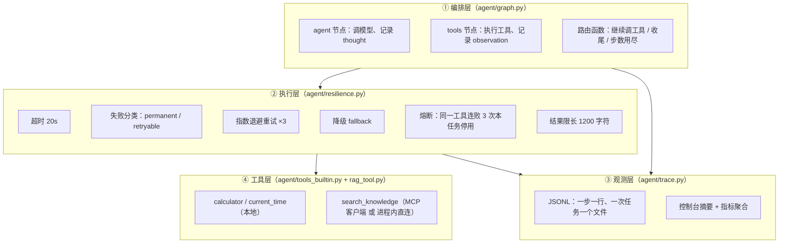
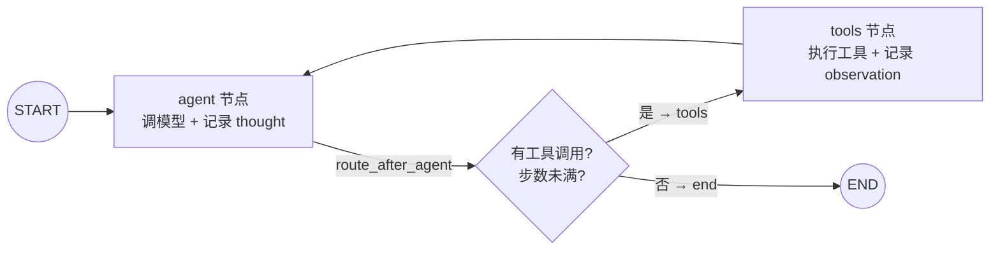

# hello-agent 讲解指南：从「没写过 Agent」到「能对着源码讲」

> 这份文档的用途：**备面试**。
> 上半部分（第 1~5 节）是零基础讲解——读完能看懂这个项目每一行在干什么；
> 下半部分（第 6~7 节）是「面试怎么讲」——60 秒电梯稿、3 分钟项目介绍稿、
> 对齐面试官最关心的**五个问题**的标准答案、以及 13 条高频追问的答法。
>
> 配套阅读：仓库根目录 `README.md`（安装、运行、真实日志）。

---

## 1. 一句话说清这个项目是什么

**hello-agent = 一个「能自己决定调哪个工具、调完看结果、再决定下一步」的最小 Agent。**
它用 **LangGraph** 把「模型思考 → 调工具 → 看结果 → 再思考」这个循环显式地画成一张图，
并且给这个循环装上三样工程护栏：**最大步数、失败重试/降级、全链路 trace 日志**。

它一共只做三件事，但每一件都做完整：

| 工具 | 干什么 | 说明 |
|---|---|---|
| `search_knowledge` | 检索本地知识库（返回片段 + 相似度分数 JSON） | **经 MCP 客户端接入项目一 [rag-mcp-server](../../rag-mcp-server)**，故障时降级为进程内直连 |
| `calculator` | 算数（AST 白名单求值，无 `eval`） | 不让模型心算——大模型的算术不可靠 |
| `current_time` | 当前时间（东八区，精确到秒） | 模型的「今天是几号」是训练时的记忆，不可信 |

> 为什么「检索」要通过 MCP 绕一圈？因为**进程隔离**：BGE 向量模型和知识库索引都在
> rag-mcp-server 子进程里，Agent 进程保持轻量；同一个 Server 还能同时被 Claude Desktop、
> Cursor 复用（详见 README「RAG 工具的两种形态」）。

---

## 2. 零基础铺垫：ReAct 循环到底是什么

先忘掉框架。一个「会用工具」的 Agent，核心逻辑就是下面这 10 行伪代码：

```text
messages = [系统提示词, 用户任务]
while 步数 < 上限:
    回复 = 模型(messages)                       # ① 思考：要回答，还是先调工具？
    if 回复.没有工具调用:
        return 回复.内容                        # 答完了，退出循环
    for 调用 in 回复.工具调用:
        结果 = 执行工具(调用.名字, 调用.参数)    # ② 行动
        messages += [调用, 结果]                # ③ 观察：把结果塞回上下文
return "未完成：步数用尽"                        # 兜底退出
```

看三遍就能明白的三个关键点：

1. **循环的「大脑」是模型本身**——要不要调工具、调哪个、传什么参数，全是模型看了
   「系统提示词 + 历史消息」后现场决定的，**没有 if-else 规则树**。这就是 Agent 与
   Workflow 的区别（Workflow 是流程由代码写死，Agent 是流程由模型现场决定）。
2. **工具的名字和参数说明也是提示词**——模型的「工具清单」来自工具函数的名字、
   参数签名和 docstring。**工具描述写得好不好，直接决定模型选得对不对**
   （第 5.2 节展开）。
3. **工具结果会永久留在上下文里**——每轮的工具返回值都会追加进 `messages`，
   所以工具结果多长、多少条，直接决定 token 成本（第 5.3 节讲怎么控）。

上面这段伪代码在真实项目里会膨胀出一个「工程系统」，本项目的做法是把它拆成四层：



---

## 3. 跟着一次真实运行走一遍

拿仓库里真实跑过的 Demo 1 举例（完整日志在 README）：

> 任务：先查知识库，LoRA 的典型配置里 r 和 α 分别是多少？然后用计算器算 α/r，最后告诉我现在的时间。

**Step 1（模型思考 + 并行调两个工具）**

```text
[step 1] llm_call 1311.1ms tokens=in807/out96
[step 1] thought: I'll start by searching the knowledge base for LoRA configuration details and getting the current time.
[step 1]   → action: search_knowledge({"query": "LoRA 典型配置 r 和 alpha 取值", "top_k": 5})
[step 1]   → action: current_time({})
[step 1] observation[search_knowledge] ok in 20.92ms (attempt=1): {...matched: 4...}
[step 1] observation[current_time] ok in 2.87ms (attempt=1): {"human": "2026年10月16日 13:20:50 星期五"}
```

发生了什么：
- 模型看到任务后，**一次回复里给出了两个工具调用**（检索 + 取时间）——这是模型的自主决策，不是代码写的规则；
- `agent` 节点的路由函数发现「有工具调用且步数未超」→ 交给 `tools` 节点；
- `tools` 节点**按顺序**执行这两个调用（为什么串行不并发？见第 6.4 节 Q4），
  每次都过一遍执行层（超时/重试/熔断都在这里），结果各自记一条 `observation`；
- 两条 `ToolMessage` 追加进 `messages`，回到 `agent` 节点开始 Step 2。

**Step 2（模型基于观察做了算术）**

```text
[step 2] thought: 知识库找到了配置，现在计算 α/r。
[step 2]   → action: calculator({"expression": "16/8"})
[step 2] observation[calculator] ok in 0.72ms (attempt=1): {"ok": true, "expression": "16/8", "result": 2}
```

模型从检索片段里读出了 r=8、α=16，然后**主动**调计算器算 16/8=2。
注意它把「读文档 → 提参数 → 算数」拆成了两步，而不是一口气心算——这正是系统提示词里
「需要算术时调用 calculator，不要心算」在起作用（提示词原文见 `config.yaml`）。

**Step 3（不再调工具 → 收尾）**

```text
[step 3] llm_call 1129.18ms tokens=in1688/out141
[step 3] thought: **1. LoRA 典型配置**（来源：`finetuning.txt`）- r = 8，α = 16 ...
[run ec54f31d] 结束：status=completed steps=3 耗时=9178.84ms
```

这一轮模型只输出文字、没有工具调用 → 路由函数判定 `completed` → 走到 `END`。
整个决策链被逐行写进 `traces/run_20261016-132043_ec54f31d.jsonl`：
**每个 thought / action / observation 都是可回放的证据。**

---

## 4. 代码地图：每个文件回答什么问题

| 文件 | 职责 | 面试官可能对应的问题 |
|---|---|---|
| `run.py` | 命令行入口（任务 + `--rag-mode` + `--max-steps`） | — |
| `agent/graph.py` | **编排**：状态定义、agent/tools 两节点、路由函数 | 「状态存在哪里」「循环怎么停」 |
| `agent/resilience.py` | **执行层**：超时/失败分类/重试/降级/熔断/限长 | 「失败如何分类」「重试还是降级」 |
| `agent/trace.py` | **观测**：JSONL 事件流 + 控制台摘要 + 脱敏 | 「链路追踪怎么设计」 |
| `agent/tools_builtin.py` | 计算器（AST 白名单）与时间工具 | 「副作用如何约束」「Prompt 注入怎么防」 |
| `agent/rag_tool.py` | RAG 工具的两种形态（MCP 客户端 / 进程内直连） | 「MCP 是什么」「为什么要进程隔离」 |
| `agent/toolkit.py` | 工具集组装 + `auto/mcp/direct` 三档切换 | 「依赖故障怎么办」 |
| `agent/runner.py` | 一次任务的装配与收尾、状态与指标聚合 | 「结果由谁验证」「指标怎么算」 |
| `agent/llm.py` / `agent/config.py` | OpenAI 兼容端点装配；密钥脱敏 | 「换模型要改多少代码」 |
| `scripts/demo_tasks.py` | 三条固定 demo 任务（证据生成器） | — |
| `tests/`（152 个；其中 151 个完全离线，1 个需设 `HELLO_AGENT_TEST_MCP=1`） | 离线可跑的行为断言（含假模型脚本化） | 「你怎么测试一个概率性系统」 |

---

## 5. 五个机制的展开讲解

### 5.1 循环与状态：`agent/graph.py`

状态只有三个字段（`AgentState`）：

```python
messages: Annotated[List[AnyMessage], add_messages]  # 全部对话+工具消息，追加而非覆盖
steps:    int                                        # 已经走了几轮「模型思考」
status:   str                                        # new / in_progress / completed / llm_error
```

图结构只有两个节点和一条条件边：



三个「为什么这么设计」：

1. **为什么用 StateGraph 手写而不是 `create_react_agent` 一行搞定**：
   框架封装掉的恰恰是面试要问的东西——步数怎么数、错误怎么回灌、状态放在哪。
   手写之后，这三件事都在自己的代码里，可以逐行讲（这也是本仓库最主要的取舍，
   代价是多了约 100 行编排代码）。
2. **为什么用 `steps` 而不是框架的 `recursion_limit` 限步**：`recursion_limit` 数的是
   「图走了几个节点」（一轮循环=agent+tools 两个节点），是**防御性兜底**；
   业务上要限制的是「模型最多思考几轮」= `max_steps`（默认 6）。
   两者语义不同，本项目都配了（`recursion_limit: 25` 只是兜底）。
3. **为什么步数用尽时不再执行最后那批工具调用**：如果第 `max_steps` 轮的模型还在请求
   工具，这批调用的结果**永远不会被模型消化**（没有下一轮了），执行它们纯属浪费
   （检索要花几十毫秒到几秒），所以路由函数直接收尾，并生成一段
   「未完成说明」告知调用方为什么停下来（真实证据见 README 的 `max_steps_exceeded` 日志）。

### 5.2 工具契约：写给人看，也写给模型看

模型选工具靠的是**工具描述**（名字 + 参数 + docstring）。本项目三个工具的描述都遵循同一套写法：

- **说清什么时候用它**：`current_time` 的 docstring 明确写「任何涉及『今天/现在/今年』的
  问题都要先调用它拿真实时间，**不要用模型记忆里的日期**」——直接抑制了幻觉；
- **说清边界**：`calculator` 写清「只支持数字与四则运算 + 白名单函数」，模型就不会乱传表达式；
- **返回值统一用 JSON、且永不抛异常**：参数错了也是返回 `{"ok": false, "error": ..., "hint": ...}`。
  这样**错误是「可读的观察」而不是「流程崩溃」**——模型看到 `hint` 会自己改参数重试。
  真实例子：Demo 2 里模型想用 `ceil(...)`，被白名单拒绝并回了一条 hint，
  它下一轮就自己改成整数运算 `(5000-50+974-1)//974` 算对了（README 有完整日志）。

### 5.3 失败分类与恢复：`agent/resilience.py`（本项目的可靠性核心）

所有工具调用都从 `ToolExecutor.execute()` 走，它按失败种类分成四档处理：

| 类别 | 典型来源 | 处理策略 | 为什么不换一种做法 |
|---|---|---|---|
| **permanent**（参数错/工具不存在） | 模型给错参数、幻觉出不存在的工具 | **不重试**，把「正确用法」回给模型让它自己修 | 同样参数重试必然同样失败，纯烧时间 |
| **retryable**（超时/连接/限流/5xx） | 网络抖动、依赖限流 | **指数退避重试**，最多 3 次（0.5s→1s→2s，上限 4s） | 瞬时故障等待后大概率自愈 |
| **exhausted → 降级** | 依赖长时间不可用 | 调用该工具注册的 **fallback**：`search_knowledge` 的 MCP 通道坏了就切**进程内直连**同源检索 | 有替代路径就别让任务整体失败 |
| **熔断** | 同一工具连续失败 3 次 | **本任务内临时禁用**该工具，并在 observation 里告知模型别再调 | 不然模型会把剩余步数全浪费在必然失败的调用上 |

外加三条硬约束：
- **超时**：每次工具调用 `asyncio.wait_for(..., timeout=20s)`——一个卡死的工具不能拖死整个任务；
- **输出限长**：工具结果进上下文前截断到 1200 字符并标注「已截断，
  原长 N 字符」——上下文成本握在自己手里（这也是被问「返回过长怎么办」时的答案）；
- **熔断状态不跨任务**：执行器每个任务新建一次，下一个任务重新给依赖一次机会。

★ **熔断没有 half-open，这是有意的**（被追问「为什么不做半开探测」时的答案）：
执行器的生命周期 == 一个任务（默认最多 6 步），熔断的目的就是
「别把本任务剩下的步数浪费在必然失败的调用上」；冷却后放一次探测，在
「依赖整个任务期间都是坏的」（最常见情形）下只是**多浪费一步**。
而且「依赖恢复了」在本任务内用不上——任务结束就换新执行器。真正的 half-open
（冷却窗口 + 半开探测）应该放在**跨任务共享状态的长驻服务**里。

★ **工具结局是三分类，成功率的口径必须说准**（容易被追问「你这个成功率怎么算的」）：

| 结局 | 含义 | 计入 |
|---|---|---|
| `ok` | 主通道成功 | `tool_ok` |
| `degraded` | **降级成功**：主通道坏、fallback 好，调用方真的拿到了可用结果 | `tool_degraded` |
| `failed` | 最终失败，没拿到结果 | `tool_failed` |

`tool_ok + tool_degraded + tool_failed == tool_calls`（互斥、穷尽）；
**成功率 = (ok + degraded) / calls**（分母是工具调用总数，**降级成功算成功**），
主通道健康度另给一个 `tool_success_rate_main = ok / calls`。
> 这里修过一个自相矛盾的口径：老实现进降级分支前就把 `failed` 加了、降级成功时又不加 `ok`
> → 降级成功被算成失败（成功率直接 0），且 `ok + failed` 还大于 `calls`。
> 现在 `agent/runner.py` 的 metrics 与 `agent/usage.py:summarize_tool_outcomes()`（从 trace 离线重算）
> 是同一套口径，两个地方的数字必然对得上（有测试守着）。

失败分类的判定顺序（`classify_error()`）：先看异常类型
（`ValidationError / TypeError / ValueError / KeyError / AttributeError` → permanent），
再按关键词命中表（timeout / connection / rate limit / 429 / 502 / 503 / 504 → retryable），
**未知异常一律按 retryable**——因为「多试一次」的代价远小于「直接放弃」。
这条「保守兜底」的偏好本身就是一个可讲的决策点。

### 5.4 观测：`agent/trace.py`

设计目标一句话：**一次任务一个 JSONL 文件，一条事件一行 JSON，跑完可完整回放**。

```text
traces/run_20261016-132218_3941a1d2.jsonl    ← 文件名的含义：时间戳 + 8 位短 run_id
```

每个事件都有公共字段 `ts / run_id / step / type`，`type` 的取值与含义：

| type | 含义 |
|---|---|
| `run_start` | 任务开始（含任务文本、**已脱敏**的端点信息、max_steps、rag_mode） |
| `toolset` / `toolset_fallback` / `tools_ready` | 工具集就绪；MCP 连接失败时的降级原因也在这里留证 |
| `checkpoint_ready` | 断点续跑就绪：后端（`sqlite` / `jsonl` / `disabled`）、thread_id、落盘路径、降级说明 |
| `resume_detected` / `resume_noop` | 检测到未完成状态（带 `next_nodes` / `steps_done`）→ 本次是续跑；或 `--resume` 但没东西可续 |
| `llm_call` | 一次模型调用的耗时与 token 用量 |
| `thought` | 模型这一轮的文本 + 它请求的工具调用列表 |
| `action` | 发起一次工具调用（含尝试序号，重试时会出现多次） |
| `retry` | 一次可重试失败 + 退避秒数 |
| `observation` | 工具结果（成功给 truncated 预览；失败给 error_class 与可操作建议） |
| `degrade` / `circuit_open` | 降级触发 / 熔断触发 |
| `max_steps_reached` / `run_end` | 收尾：状态、步数（含 `steps_this_run`）、指标、最终回答、trace 路径 |

三条工程细节，都是面试官爱追的：

1. **脱敏**：所有字符串过 `mask_secret()`，密钥在 trace 里**永远是 `sk-****`**；
   有专门的测试用例 `test_trace_never_leaks_api_key` 守着这条红线（151 个测试之一）。
2. **指标聚合**：`run_end` 里带着 `metrics`——`tool_calls / tool_ok / tool_degraded / tool_failed /
   tool_succeeded / tool_retries / circuit_opens / tool_success_rate / tool_success_rate_main /
   context_over_budget / event_counts`。
   这些字段是现成的「Agent 效果统计」数据源（下一步做工具选择正确率评测时直接复用）；
   工具口径还能**离线重算**（`agent/usage.py:summarize_tool_outcomes()` 读 trace 里的 `observation` 事件）。
3. **控制台与文件分离**：控制台只打摘要（每条截断到 200 字符，避免刷屏），
   文件里存完整事件——人可以看摘要，机器可以 `jq` 统计。

### 5.5 RAG 工具的两种形态：`agent/rag_tool.py`

| | 形态 A：MCP 客户端（默认） | 形态 B：进程内直连（direct） |
|---|---|---|
| 实现 | `langchain-mcp-adapters` 以 stdio 拉起 rag-mcp-server 子进程，走标准 MCP JSON-RPC | 把 rag-mcp-server 仓库加进 `sys.path`，直接调同源 `KnowledgeService` |
| 优点 | 进程隔离（BGE 模型/索引在子进程）；同一个 Server 可复用给 Claude Desktop / Cursor | 零子进程开销；调试方便 |
| 代价 | 子进程启动 + 预热约 5s（每次任务） | BGE 模型加载进 Agent 进程（约 5s、几百 MB 内存） |
| 用途 | 默认路径（`config.yaml: tools.rag.mode: auto`） | ① MCP 故障时的**降级路径**；② 轻量跑法（`--rag-mode direct`） |

`auto` 模式的两个层次：
1. **连不上就换**：整个任务只建一次 MCP 会话（`client.session(...)` 上下文），连接失败 → 直接改用 direct 工具，并在 trace 里写 `toolset_fallback` 事件留证；
2. **连上了但调用失败**：MCP 版工具重试耗尽 → `ToolExecutor` 触发 fallback（懒加载，正常路径下永远不会把 BGE 加载进 Agent 进程）。

> ⚠️ 版本事实（面试可讲，是真实的适配层细节）：`langchain-mcp-adapters 0.3.2` 要求
> `mcp<2`，所以客户端是 **mcp 1.30.0**，而 rag-mcp-server 服务端用的是 **mcp 2.3.0**
> ——两者能互通，因为互操作的依据是**协议**（JSON-RPC 方法名/报文结构），不是 SDK 版本。
> 本仓库有一个端到端测试（`HELLO_AGENT_TEST_MCP=1` 时执行）真实跑通这条链路。

### 5.6 token 用量与成本：`agent/usage.py`

一句话：**成本是「步数 × 上下文长度」的函数，不量化就没法优化，也答不上「跑一次多少钱」**。

| 层次 | 口径 | 落在哪 |
|---|---|---|
| 单任务 | 这次运行的 in/out tokens、模型调用次数（有用量/无用量分开计） | `run_end.metrics["usage"]` + 控制台一行摘要 |
| 累计 | 扫 `traces/*.jsonl` 重算求和 | `scripts/usage_report.py`（可导出 json/md） |

三个可讲的取舍：
1. **事实源是 trace 不是账本**：`summarize_usage(events)` 是纯函数，任何时刻都能对已落盘的 JSONL
   重算成本（换单价表、复查某次为什么贵），不会出现「账本和 trace 对不上」；
2. **算不出价只报 token**：单价表是配置项（`llm.pricing` 按模型名匹配），没命中就
   `estimated_cost_usd=None` 并明说「不在单价表」，不猜；
3. **端点不返回 usage 时明示**（`llm_calls_without_usage` 单独计数），而不是把「没有数据」当 0。

provider 差异也有兜底：优先 `usage_metadata`，退回 `response_metadata.token_usage`。

### 5.7 断点续跑：`agent/checkpointing.py`

一句话：**进程挂了不该白跑，更不该把已经执行过的工具调用再放一遍**（有副作用的工具会真金白银损失）。

- 给图挂 checkpointer，以 `thread_id` 为键；每个 super-step 落一次状态；
- 同 `thread_id` 重跑时，用 `StateSnapshot.next` 判断「上次跑完了没」：
  **`next` 非空 = 停在中间 → `input=None` 只补跑未完成节点**（已完成的步骤/工具调用不重放）；
  `next` 为空 = 已到 END → 当作同一 thread 的**新一轮**（追加新任务，不重置步数）；
- 后端：默认 `auto` → 优先官方 `AsyncSqliteSaver`，依赖不可用自动退到**本仓库自研的
  `JsonlCheckpointer`**（`InMemorySaver` 子类 + JSONL 落盘，复用官方 serde 序列化，
  原子写盘）；两个后端跑**同一套**续跑测试，等于把「自研实现与官方语义一致」变成回归测试；
- 硬证据（`scripts/demo_resume.py`，离线可复现）：`calculator` 调用次数 1 → 1（**重放步数 = 0**），
  `crashy` 1 → 2（只补跑失败那一步），模型调用 2 → 1（没把前面两步重算），trace 里有
  `resume_detected next=['tools'] steps_done=2`。

**边界（被追问时要主动说）**：checkpoint 保证的是**状态**一致，不是**副作用**一致
（工具副作用不保证幂等，要幂等键/补偿逻辑）；sqlite 是单机单文件，多 Worker 场景要换 PostgresSaver。

---

## 6. 面试怎么讲

### 6.1 电梯稿（60 秒，背下来）

> 「我用 LangGraph 手写了一个最小 ReAct Agent：状态就三个字段——消息列表、步数、状态；
> 循环靠一个路由函数决定『继续调工具还是收尾』，硬上限是业务语义的最大步数。
> 工具三个：经 MCP 接入的 RAG 检索、AST 白名单计算器、时间——**RAG 检索故障时会降级到进程内
> 直连**同源实现。每次运行落一份 JSONL trace，每步 thought/action/observation 可回放，
> 里面带工具调用成功率、token 与估算成本。任务跑到一半进程挂了也能用同一个 thread_id 续跑，
> 已完成的工具调用不会重放。151 个测试完全离线可跑（另有 1 个 MCP 端到端用例显式开启），
> 三次真实模型运行的日志与 trace 都在仓库里。」

### 6.2 项目介绍稿（3 分钟，STAR）

- **S（背景）**：我要证明自己不只是「用过 LangChain」，而是能把大模型的概率性能力
  放进一个**可观测、可验证、可恢复**的确定性系统里。
- **T（任务）**：两周内产出两个能跑、能展示、能讲源码的仓库：RAG→MCP Server（项目一）
  和这个 ReAct Agent（项目二）。
- **A（行动）**：三个关键决策——
  ① **不用 `create_react_agent` 一行封装，手写 StateGraph**，为了把最大步数、失败处理、
     trace 三件事显式化；
  ② **失败分四档**（参数错不重试 / 瞬时故障退避重试 / 重试耗尽降级 / 连续失败熔断），
     判定顺序与兜底偏好在 `resilience.py` 里都有注释说明「为什么」；
  ③ **RAG 接入做双形态**：默认走 MCP 客户端（进程隔离、可复用），
     MCP 不可用时降级进程内直连，两条路径返回**同一份 JSON 契约**，模型无感知。
- **R（结果）**：3 条真实任务全部 completed（步数 3/4/2、总耗时 30.97s、工具调用 10 次全成功）；
  人为设 `max_steps=1` 能稳定得到「未完成收尾」而不是假答案；把 MCP 命令改坏后
  `auto` 模式如实降级到 direct 并完成任务；测试默认 `151 passed, 1 skipped`，
  开启 `HELLO_AGENT_TEST_MCP=1` 后 152 项全过。

### 6.3 对齐面试官最关心的「五个问题」

2026 年字节面经的原话是：面试官反复确认「**候选人是否能把大模型的概率性能力，
放进一个可观测、可验证、可恢复的确定性工程系统中**」，高质量回答要说清五个问题。

| 五问 | 本项目的答案（都指得到源码） |
|---|---|
| **① 状态存在哪里？** | `AgentState` 三个字段：`messages`（`add_messages` 追加语义）/ `steps`（步数即限制依据）/ `status`。**状态就是这三样，没有藏在框架黑盒里**。跨请求的「记忆」本项目不做（单任务会话），要扩就是把这个 state 落库 + 做压缩（诚实说明这是已知边界）。 |
| **② 失败如何分类？** | 四档：permanent（参数错，不重试）/ retryable（超时/连接/限流/5xx，退避重试）/ exhausted→降级（切 fallback）/ 熔断（连败 3 次本任务停用）。判定在 `classify_error()`，未知异常按 retryable 兜底。 |
| **③ 副作用如何约束？** | ① 计算器无 `eval`（AST 白名单，禁属性访问/导入/下标，见 `tools_builtin.py`）；② 时间工具**时区在构造时固化**，模型传不进任意字符串；③ 工具全部**只读**（检索/计算/取时间），本项目没有写操作工具，所以「幂等重试」是天然成立的——如果以后加写工具，约束思路是：先做「工具白名单 + 参数 schema」，再上幂等键/审批闸门（这题只说方向，不吹已实现）。 |
| **④ 结果由谁验证？** | 分两层：**确定性的部分交给测试**（151 个完全离线的测试 + 1 个显式开启的 MCP 端到端；用假模型脚本化，把「模型行为」变成可注入的输入）；**概率性的部分交给 trace + 人工核对**——每次回答都要求模型说明依据来自哪个来源文件，raw 片段在 observation 里可回放。**没有**做的是「用 LLM 自动 Judge Agent 的回答质量」，这是明确的下一步。 |
| **⑤ 效果怎样用指标证明？** | 现有：每次 run 的 `metrics`（工具调用成功率、步数、重试/降级/熔断次数）已经全量落 JSONL，可直接聚合；检索层的 Recall@K 归项目一/评测平台。**下一步**（计划中，未做不吹）：造 15–20 条 query 统计「工具选择正确率 / 参数正确率 / 平均步数 / 失败恢复率」。 |

### 6.4 高频追问 13 条

**Q1：为什么手写循环，不用 `create_react_agent` / 官方 prebuilt？**
答：封装越深，越讲不出「步数怎么数、错误怎么回灌、状态在哪」。手写后这三件事都是
一屏代码（`graph.py` 157 行含注释），代价是多了约 100 行编排代码——对本项目的目标
（可讲、可控、可观测）值得。上线业务我会先评估框架，但**评估的前提是知道框架封了什么**。

**Q2：为什么状态不用字典/不用对象，而用 TypedDict + `add_messages`？**
答：`add_messages` 是 LangGraph 的 reducer——声明「新消息追加而不是覆盖」，
这样节点可以只返回增量。三字段都有明确用途，没有为了框架硬塞字段。

**Q3：`recursion_limit` 和 `max_steps` 有什么区别？**
答：前者是**图步数**兜底（一轮循环=2 个节点），防御性配置；后者是**业务语义**的
「最多思考几轮」。两个都配：`max_steps=6` 管业务，`recursion_limit=25` 管「不管出什么鬼都不死循环」。

**Q4：一轮里模型并发请求了多个工具（Demo 1 就是两个），你怎么控顺序？**
答：当前**串行执行**，理由：① 工具集只有三个、耗时都在毫秒级，串行的额外成本可忽略；
② 串行让 trace 的归因完全线性（一步一条 observation，出问题好定位）；
③ 有依赖关系的调用（先检索拿参数、再算数）本来就只能串行——模型自己会把有依赖的
调用分到不同轮。要做并发的话，改动点在 `tools_node` 的 for 循环换 `asyncio.gather`，
但**有副作用的工具不能并发**（本项目工具全只读，所以是安全的）。

**Q5：工具失败重试还是降级，怎么选？**
答：先分类再决定。参数错重试无意义（permanent）→ 直接把用法回给模型让它改；
瞬时故障（超时/限流/连接）→ 退避重试，最多 3 次；**重试耗尽后**才谈降级——
降级的前提是「有语义等价的替代路径」（本项目的 fallback 是进程内直连同源检索），
没有 fallback 就返回「明确失败 + 可选出路」，让模型基于已有信息回答或如实说查不到。
另外同一工具连续失败 3 次会熔断，避免把步数浪费在必然失败的调用上。

**Q6：工具描述怎么写，模型才选得对？**
答：三件事：**说清触发时机**（`current_time` 里写「任何涉及今天/现在的问题都要先调它，
不要用模型记忆里的日期」）；**说清边界**（计算器写明只支持哪些运算，减少非法参数）；
**错误也要写成可读的观察**（`{"ok": false, "error": ..., "hint": ...}`）——
模型看到 hint 会自我修正，Demo 2 里 `ceil` 被拒后它自己换成了整数运算，这是日志里的真实过程。

**Q7：工具返回内容过长怎么办？**
答：**进上下文前截断**（1200 字符 + 标注「已截断，原长 N 字符」）。设计上把「截断」
放在执行层而不是工具里，所有工具统一受管。更进阶的做法是「工具结果分层」：
大结果落文件、上下文里只放摘要 + 引用（本项目没做到那一步，如实说）。

**Q8：上下文/记忆超长怎么办？（美团常问）**
答：控制上下文有两条已经落地的机制：① 送模型前按字符预算做**确定性压缩**
（只压内容、不删消息，保住 `tool_calls ↔ ToolMessage` 配对）；② 工具结果限长 1200 字符、
单条记忆限长 2000 字符。跨任务记忆是**词法 BM25 召回 + 按相关度注入 top-k**（单机 JSONL，
不是语义检索，如实说）。要再扩的方向：历史消息按「工具观察块」做摘要压缩
（丢工具历史会导致模型复述错误，所以要保留「结论 + 来源」而不是原样截断），
以及把长期记忆换成语义检索（这正是项目一 RAG 的定位）。

> ★ 两个容易被追问的细节（已落地、且口径写在 README §5.6 / §5.5）：
> ① **字符预算是「目标」不是「硬上限」**——三档预览用完仍超预算时，返回尽力压缩后的结果，
> 并在 stats 里写明 `over_budget` / `over_budget_chars` / `budget_floor_hit`（压没压住是看得见的，
> 不能删消息是因为要保协议配对）；② **长期记忆能写也能删、能过期、能标可信度** ——
> `forget(key)` 删除并落盘、`ttl_seconds` 过期后不参与召回、
> 每条记录带 `source`（来源）与 `verified`（是否已核验，默认 False，召回可只取已核验的）。

**Q9：MCP 是什么？没有 MCP 之前工具调用怎么做？**
答：MCP 是 Anthropic 2024 年底提出的开放协议，用 JSON-RPC 把「模型 ↔ 工具/数据源」
标准化：一次实现，任何 MCP 客户端（Claude Desktop / Cursor / 自己的 Agent）都能用。
之前每家框架各自实现（OpenAI function calling、LangChain Tool、各家插件规范），
换宿主就要重写适配。本项目把检索封装成 MCP Server 后，**同一个检索能力同时喂给
桌面宿主和自己的 Agent**，不重复实现；stdin/stdout 传 JSON-RPC，无需端口和鉴权配置。
（协议本身版本兼容：客户端 mcp 1.x 与服务端 mcp 2.x 在本项目真实互通。）

**Q10：链路追踪怎么设计？（2026 新重点）**
答：三原则——**一次任务一个文件**（可回放）、**一条事件一行 JSON**（可 jq/grep 统计）、
**统一字段 + 类型枚举**（`ts/run_id/step/type`，type 见第 5.4 节）。加两条工程纪律：
敏感信息强制脱敏（有测试守着）、内容截断控长。落地收益：32 行的 trace 就能回放
一次「模型被拒 → 自我纠正 → 算对」的完整过程。

**Q11：成本怎么控？**
答：可量化的三处——① 工具结果限长 1200 字符（上下文直接变短）；
② 检索结果自带相似度分数和阈值过滤，模型能自己判断「证据够不够」而不是反复检索；
③ **每次运行的 token 与估算成本直接落进 `metrics.usage` 和控制台摘要**（`agent/usage.py`：
参数化单价表 + 纯函数聚合），累计成本扫 trace 重算（`scripts/usage_report.py`），
所以「贵在哪一步」是可归因的（`llm_call` 事件逐条带 usage）。
结构性的取舍：MCP 子进程每次任务启动+预热约 5s（Demo 里 `connect_ms≈5.4s`），
换来的是 Agent 进程不必加载 BGE——**CPU/内存换启动延迟**，这是有意的交易。

**Q13：进程挂了 / 用户 Ctrl-C 了，任务怎么办？（断点续跑）**
答：给 LangGraph 图挂 checkpointer（以 `thread_id` 为键），每个 super-step 落一次状态；
重跑时用 `StateSnapshot.next` 判断上次停在哪：非空就 `input=None` 只补跑未完成节点，
**已完成的工具调用不会重放**（实测：`calculator` 调用次数 1→1，重放步数 = 0），
trace 里留 `resume_detected` 事件。后端 `auto`：优先官方 sqlite saver，
依赖不可用则退到我自己的 JSONL saver（两个后端跑同一套测试）。
**主动说边界**：它保证状态一致、不保证副作用幂等（下单/写文件这类要幂等键）；
单机单文件，多 Worker 要换 PostgresSaver。

**Q12：Prompt 注入怎么防？**
答：注入的入口是「不可信文本进上下文」——本项目的不可信文本主要是**知识库内容**和
**模型自己生成的参数**。防法：① 模型生成的参数**永远不当代码执行**（计算器是 AST
白名单，不是 `eval`——这是最实的一条）；② 时间工具不接受任意时区字符串；
③ 工具输出只作为 observation 文本注入，不会被当指令执行；④ 真实业务里再加
「工具白名单 + 危险工具人工审批」。本项目没有联网工具，所以注入面很窄——这一点如实说，
比背一堆防注入话术更可信。

### 6.5 诚实边界：这些话说出口就失实，别说

- ❌「上线 / 生产环境 / 有用户量 / 支撑 QPS」——本项目是个人 demo，**没有部署**；
- ❌「多 Agent 协作 / 任务规划 / 长期自主运行」——真的没做，本项目是单任务、单 Agent；
- ⚠️ 记忆是**词法 BM25**（不是语义检索）、单机 JSONL、无并发写锁；
  评测集 50 条（带 ground truth），但拒答/幻觉判定是**关键词启发式**，
  指标只作回归参考、不代表线上分布；
- ⚠️ 断点续跑保证**状态**可恢复，**副作用不保证幂等**（要幂等键/补偿逻辑）；
  checkpoint 是单机单文件，多 Worker 要换 PostgresSaver；
- ⚠️ **本机没有配 key**，所以 README §5.7 / §5.8 里的 token 与成本数字来自
  脚本化假模型（确定性、可复现的跑法），真实端点的端到端跑批留给有 key 的环境；
  说「我用真实 API 压测过成本」就是失实；
- ⚠️ 流式输出：非流式（真要做，改动点在第 6.4 节 Q4）。
- ⚠️ 被问「你自己写的还是抄教程」时：**大方承认参考了官方文档的 ReAct 范式**，
  但设计取舍（步数语义、四档失败分类、双形态 RAG、自研 JSONL checkpointer、trace 字段）
  是围绕面试考点自己定的，每一步都能指出代码行。
- ✅ 可讲的「真实的坑」有两处，面试时是加分项：
  ① 手写循环时**漏了 `llm.bind_tools(tools)`**，模型凭记忆直答、步数=1、工具调用=0
     ——错误非常隐蔽（答案看起来还挺像样）；日志就能看出来「一步就答完」是异常信号；
  ② MCP 适配器返回的是**内容块列表** `[{"type":"text","text":...}]`，
     直接 `str()` 会让模型看到转义后的 Python repr，需要解包——适配层的坑，
     说明「协议通 ≠ 数据形状通」。

---

## 7. 自查清单（跑一遍就能验证上面每一句话）

```powershell
cd hello-agent                 # ← 换成你自己 clone 出来的路径（下文命令都在仓库根目录执行）
.\.venv\Scripts\python.exe -m pytest -q                 # 151 passed, 1 skipped（离线，不需要 key）
.\.venv\Scripts\python.exe scripts\demo_resume.py       # 断点续跑：重放步数 = 0（离线，不需要 key）
.\.venv\Scripts\python.exe scripts\usage_report.py      # token/成本汇总（单次 + 累计）
.\.venv\Scripts\python.exe scripts\demo_tasks.py --rag-mode mcp      # 三条真实任务
.\.venv\Scripts\python.exe run.py "现在几点？" --console verbose      # 单条任务
.\.venv\Scripts\python.exe run.py "任意任务" --thread-id demo-1      # 断点续跑（同 thread 未完成则接着跑）
.\.venv\Scripts\python.exe run.py --list-threads                     # 有哪些 thread、各多少 checkpoint
.\.venv\Scripts\python.exe run.py "任意任务" --max-steps 1            # 观察 max_steps_exceeded
.\.venv\Scripts\python.exe run.py "任意任务" --rag-mode direct        # 观察进程内直连
```

跑完去 `traces/` 打开最新那份 JSONL，对照第 5.4 节的事件表逐行读——
**能把一条 trace 讲成一段决策故事，这个项目就算讲明白了。**
